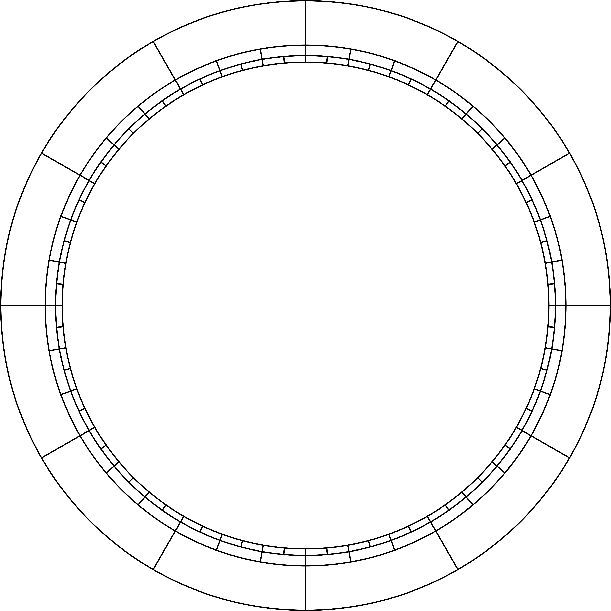
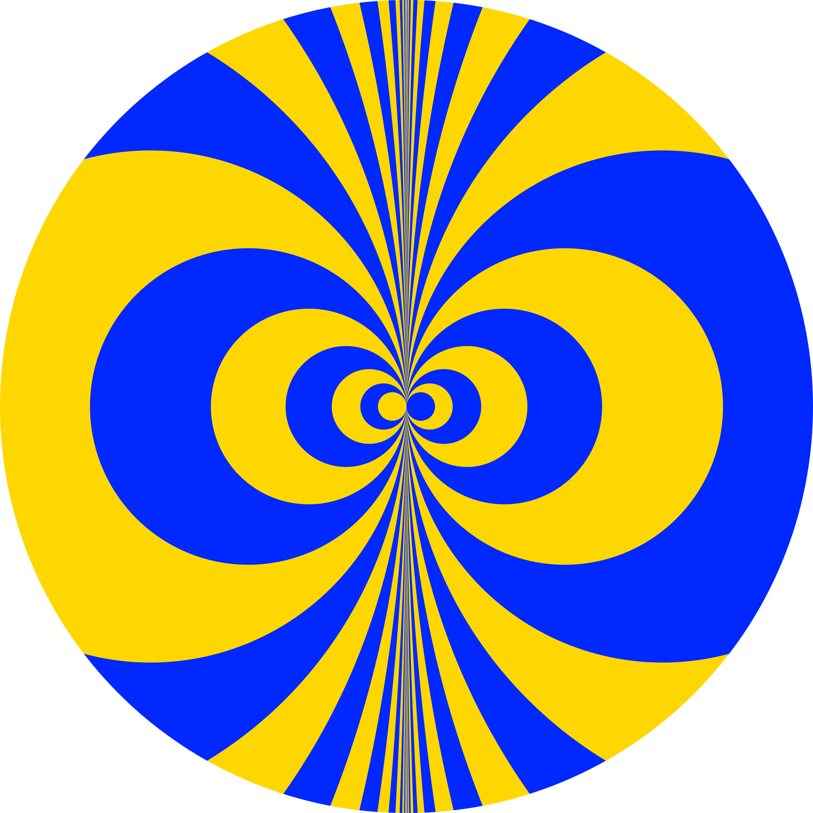

# Astrological Assets

**Open-source tooling and a curated image library for [VirgoStars](https://www.virgostars.it/) astrological interfaces.**

This public repository contains the visual assets used by VirgoStars chart interfaces, together with manifests, integrity checks, and tools for managing a shared asset collection. It is designed to work alongside [Astrological Charts](https://github.com/Cesare-ml/astrological-charts) and the wider VirgoStars ecosystem.

**1,013 raster images** · **Light and dark chart graphics** · **SHA-256 manifest** · **Node.js tooling**

> **Artwork rights notice:** This repository is public, but not every image has completed a file-specific third-party rights review. The project owner has selected **CC BY 4.0** for their original creative contributions. The separate CPAL-1.0 software license does **not** automatically cover all image content. See [Licensing and attribution](#licensing-and-attribution).

## Preview

These are individual assets from the repository, not complete rendered natal charts.

| Light chart graphics | Dark chart graphics | Solar Resonator |
| :---: | :---: | :---: |
|  |  |  |

## What's included

| Location | Contents |
| --- | --- |
| [`public/assets/img/grafici/`](public/assets/img/grafici/) | Chart backgrounds, overlays, axes, synastry elements, planetary hours, and light/dark variants |
| [`public/assets/img/simboli/`](public/assets/img/simboli/) | Zodiac signs, celestial bodies, houses, elements, and skin/size variants |
| [`public/assets/img/simboli-bianchi/`](public/assets/img/simboli-bianchi/) | White symbol variants |
| [`public/assets/img/symbols/planets/`](public/assets/img/symbols/planets/) | Circular planetary symbols and variants |
| [`public/assets/img/textures/`](public/assets/img/textures/) | Background textures |
| [`public/assets/img/risuonatore-solare.png`](public/assets/img/risuonatore-solare.png) | Solar Resonator artwork, with additional variants nearby |
| [`manifests/approved-assets.json`](manifests/approved-assets.json) | Exact asset paths, file sizes, SHA-256 hashes, and provenance metadata |
| [`scripts/`](scripts/) and [`tests/`](tests/) | Read-only verification, catalog review, selective import, and release-safety checks |

The committed image pack contains **1,013 PNG, JPG, and WebP files**. The separate [upstream candidate catalog](catalog/upstream-candidates.json) lists **1,124 candidate records**, not 1,124 additional downloadable assets. Font binaries, personal chart data, and application/backend source code are not included.

The deployed VirgoStars website is **not** automatically updated from this repository. Asset migration and release integration are separate, reviewed tasks.

## Getting started

**Requirements:** Git and Node.js **20.19 or later**. The verification scripts use the Node.js runtime; no external service, GitHub Actions, or production credentials are required.

```bash
git clone https://github.com/Cesare-ml/astrological-assets.git
cd astrological-assets

npm test
npm run audit:catalog
npm run verify:pack
npm run check:astro-spec
```

`npm run verify:pack` reads the checked-out files and checks the recorded SHA-256, size, paths, and manifest metadata. It does not modify the images or establish legal permission to redistribute them.

### Use an asset in an application

Preserve the repository's existing directory structure. For example, after copying or serving the `public/assets/` tree at your application's `/assets/` path:

```html

```

A corresponding dark variant is available at `/assets/img/grafici/dark/cartaastrale-segni.png`. Paths and filename casing matter.

For the standalone Angular/Three.js renderer, see [Astrological Charts](https://github.com/Cesare-ml/astrological-charts). That project provides a local, manifest-gated asset server for an authorized checkout:

```bash
cd ../astrological-charts
node scripts/serve-local-assets.mjs \
  --root ../astrological-assets/public/assets \
  --manifest ../astrological-assets/manifests/approved-assets.json
```

This repository contains **assets and asset-management tooling**, not the renderer or astronomical calculations.

## Integrity and maintenance

| Command | Purpose |
| --- | --- |
| `npm test` | Run Node.js tests |
| `npm run audit:catalog` | Inspect the source asset catalog |
| `npm run verify:pack` | Verify all committed images against the SHA-256 manifest |
| `npm run check:astro-spec` | Validate the **planned** 22 Unicode glyph IDs and variants; does not create a font |
| `npm run review:public -- --out ./artwork-review.local.json` | Generate a **pending-only** worksheet for human rights review |
| `npm run check:public-release` | Check image-specific public clearance records, hashes, and owner license policy |

**Expected result today:** `npm run check:public-release` returns **exit code 2**, because [`catalog/publication-approvals.json`](catalog/publication-approvals.json) has no individually cleared image records. This is intentional: being hosted on public GitHub is not evidence that every third-party element used in the images can be relicensed.

The release checker is a technical safeguard, not a substitute for provenance or legal review. The review worksheet never grants permissions automatically.

## Licensing and attribution

**Code and artwork have different licensing scopes.**

| Material | License or policy |
| --- | --- |
| Original scripts, tests, tooling, and accompanying source documentation | [Common Public Attribution License 1.0 (CPAL-1.0)](LICENSE), with the `Powered by VirgoStars` attribution specified in the license exhibits |
| Original creative contributions in images for which the owner holds the necessary rights | Owner-selected [Creative Commons Attribution 4.0 International (CC BY 4.0)](https://creativecommons.org/licenses/by/4.0/); **file-specific review of third-party components remains open** |
| Third-party fonts, glyphs, textures, maps, and other underlying works | Governed by their own rights and licenses; **not** automatically covered by the owner's CC BY 4.0 choice |
| Project trademarks and logos | Separate trademark rights; no trademark license is implied |

**Software attribution:**

> Powered by VirgoStars · https://www.virgostars.it/

**Proposed attribution for individually cleared original artwork:**

> VirgoStars — Astrological Assets (original artwork by the project owner) · [CC BY 4.0](https://creativecommons.org/licenses/by/4.0/)

CC BY 4.0 permits sharing and adaptations, including commercial use, **of material actually covered by that license**, subject to its terms (including attribution, a link to the license, and indication of changes). Some assets may incorporate font-derived glyphs or other materials whose rights are not yet established. Do not assume every file in this public repository has cleared those dependencies.

Read the [artwork licensing policy](docs/ARTWORK_LICENSING_POLICY.md), [rights review protocol](docs/RIGHTS_AND_REVIEW.md), and [open rights audit issue #2](https://github.com/Cesare-ml/astrological-assets/issues/2) before redistributing the image pack. Note that publicly accessible Git history can already have been cloned; deleting a file in a later commit does not retract earlier copies.

## Development roadmap

The next planned design milestone is **VirgoStars Astro**, a fully new symbol font owned by VirgoStars. Its first release is scoped to the traditional **12 zodiac signs and 10 celestial bodies** documented in the [font specification](docs/VIRGOSTARS_ASTRO_FONT_PLAN.md). The shapes follow the *traditional iconographic variants* chosen from the owner's reference, but the vector contours will be drawn independently. **No font is released yet.**

Follow the [prioritized roadmap and milestone checklists](docs/ROADMAP.md) and [development issue #8](https://github.com/Cesare-ml/astrological-assets/issues/8). The historical artwork/font rights review remains tracked independently in [issue #2](https://github.com/Cesare-ml/astrological-assets/issues/2).

## Contributing

Contributions to the tools, tests, documentation, and compatible original assets are welcome via issues and pull requests. Please:

- Work in **English** and follow [CONTRIBUTING.md](CONTRIBUTING.md) and [AGENTS.md](AGENTS.md).
- Preserve original asset paths unless a coordinated migration is explicitly planned.
- Include provenance and an appropriate rights review when introducing or replacing an image.
- Keep changes independently testable, with no automatic deployment or GitHub Actions.

## Documentation

- [Development roadmap and backlog](docs/ROADMAP.md)
- [Private TTF/WOFF2 font-build validation](docs/PRIVATE_FONT_VALIDATION.md)
- [Private offline visual QA (16–64 px, light/dark wheels; confidential font output)](docs/PRIVATE_FONT_VISUAL_QA.md)
- [Owner-approved 22 generated glyph images and private v0.2 font conversion](docs/APPROVED_GLYPH_IMAGES_V02.md)
- [Visual rejection of v0.1 and corrected original-font design process](docs/PROTO_V01_VISUAL_REJECTION.md)
- [Private v0.1 technical validation history (visually rejected)](docs/PRIVATE_PROTOTYPE_QA.md)
- [VirgoStars Astro — proposed original zodiac and planetary font](docs/VIRGOSTARS_ASTRO_FONT_PLAN.md)
- [VirgoStars Astro — traditional symbol variants and Unicode mapping](docs/VIRGOSTARS_ASTRO_ICONOGRAPHY.md)
- [Asset scope and upstream inventory](docs/ASSET_SCOPE.md)
- [Artwork licensing policy](docs/ARTWORK_LICENSING_POLICY.md)
- [Licensing and credits](docs/LICENSING_AND_CREDITS.md)
- [Public release checks and unresolved gates](docs/PUBLIC_RELEASE_CHECKLIST.md)
- [History file-inventory audit](docs/HISTORY_FILE_AUDIT_2026-11-12.md)
- [Font rights research](docs/FONT_RIGHTS_RESEARCH.md)
- [Ecosystem coordination](docs/ECOSYSTEM_COORDINATION.md)
- [Migration plan](docs/MIGRATION_PLAN.md)

---

Made for the [VirgoStars](https://www.virgostars.it/) ecosystem. **Powered by VirgoStars.**
